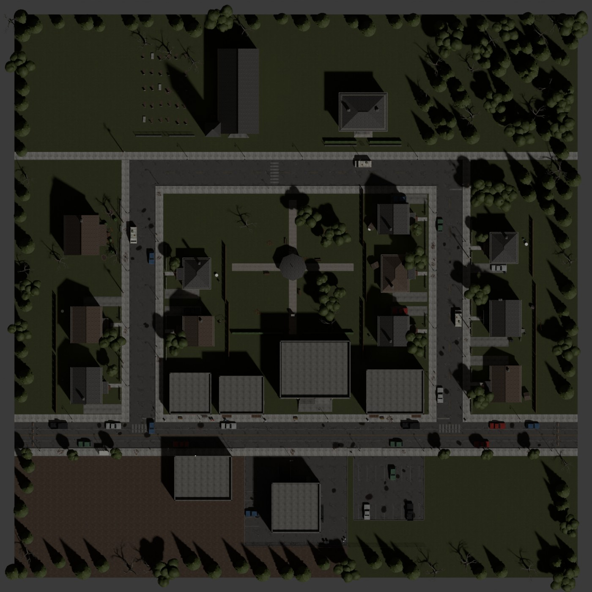
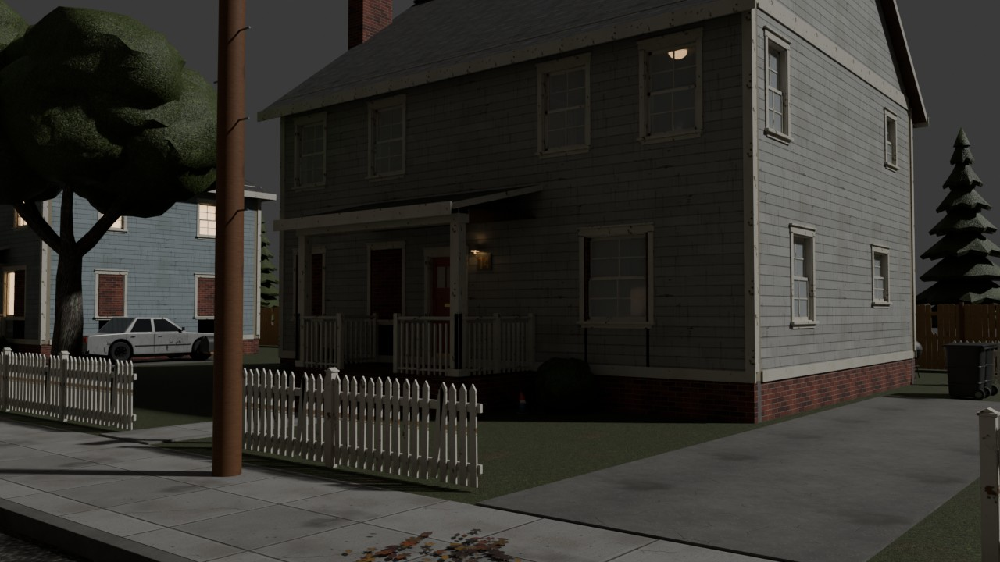
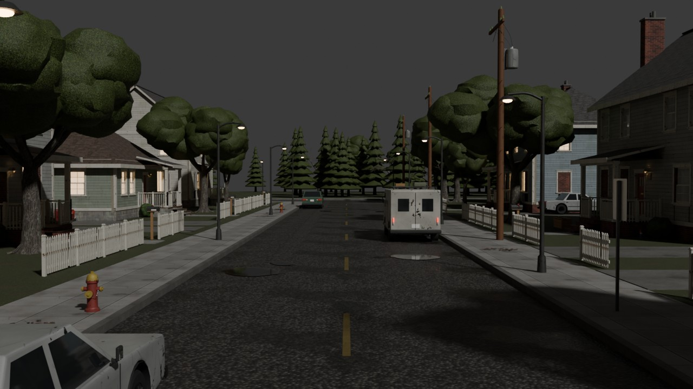
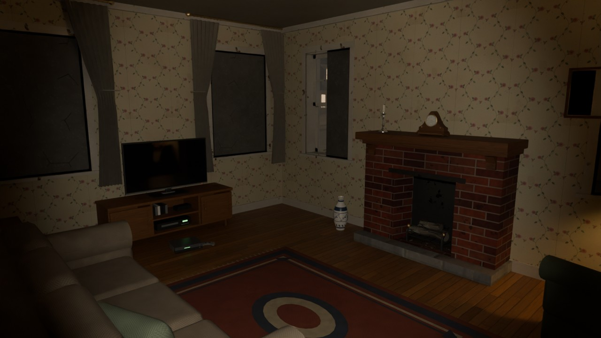
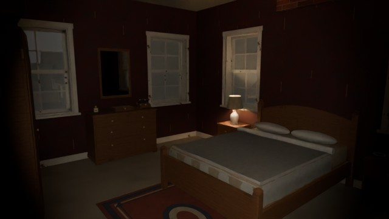
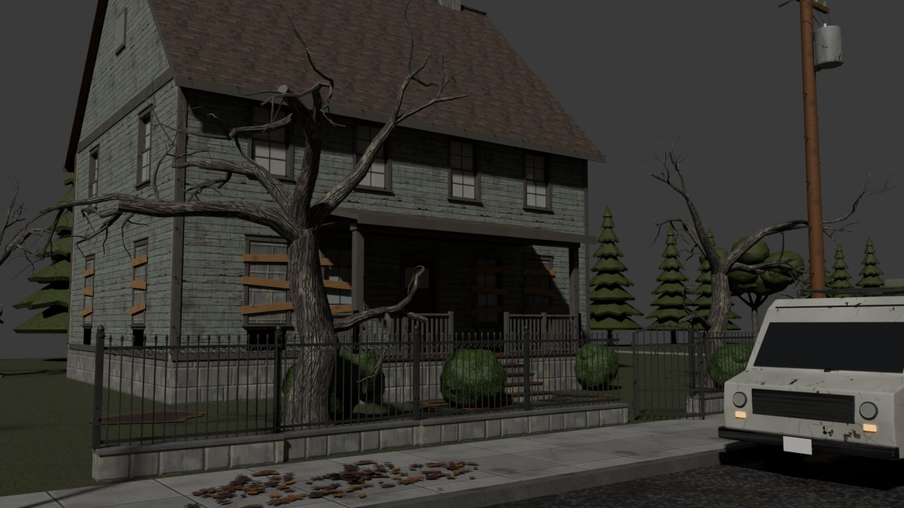

# The Quiet Job – Koop-Horror-Heist (Unreal Engine 5)

> Hollowmere, irgendwann im Oktober. Eine Crew aus bis zu vier Einbrechern plant ihre Jobs im Keller unter
> **Marlowe's Waschsalon** (der Hehler betreibt nebenan „Brannigan & Sons Plumbing“ als Tarnung). Nachts fährt
> der Van zu den Häusern der Stadt. Die Häuser sind nicht leer – und manche sind es nie gewesen.

| Die Stadt (Draufsicht) | 14 Ashgrove Lane – das erste Ziel | Ashgrove Lane |
|---|---|---|
|  |  |  |

| Wohnzimmer der Vances | Schlafzimmer (Ziel: Münzsammlung) | Das Marrow-Haus (vorbereitet) |
|---|---|---|
|  |  |  |

*(Vorschau-Renderings aus Blender/Cycles mit einer Taschenlampe an der Kamera; im Spiel rendert Unreal mit Lumen,
Volumetric Fog, eigenem Tag/Nacht-Himmel und den platzierten Lichtern.)*

Alle Modelle, Texturen, Sounds und Musikstücke wurden für dieses Projekt **selbst erzeugt** (prozedural per
Skript) – es gibt keine fremden Assets. Lizenzhinweise: `SourceArt/Audio/LICENSES_AUDIO.md`, Schriften unter
der SIL Open Font License (`Content/Slate/Fonts/Licenses`).

---

## Schnellstart

**Voraussetzungen:** Unreal Engine **5.5**, Visual Studio 2022 (17.8+) mit „Spieleentwicklung mit C++“,
„Desktopentwicklung mit C++“ und „.NET-Desktopentwicklung“ (Windows).

1. **`Build-HorrorHeist.bat`** doppelklicken (findet UE 5.5, erzeugt `HorrorHeist.sln`, kompiliert
   **HorrorHeistEditor** Win64 Development; Protokoll in **`BuildLog.txt`**).
2. Editor öffnen. Beim **ersten Start** fragt ein Dialog nach dem Aufbau der Inhalte → **Yes**. Das Setup
   (`Content/Python/hh_setup`) importiert alles aus `SourceArt/` (~256 Texturen, 175 Sounds, ~355 statische
   Meshes, 18 Skeletal-Meshes, 6 Animationen), erzeugt Materialien, baut **fünf Maps** (siehe unten) und danach alle Data Assets
   (Kosmetik, Ausrüstung, 24 Beutestücke, Jobs). Das dauert je nach Rechner 10–20 Minuten.
   - Am Ende erscheint eine Zusammenfassung; **jede Warnung** steht vollständig in
     **`Saved/HHSetup_Report.txt`** (und im Output Log, Filter „HH Setup“).
   - Jederzeit erneut ausführbar: Menü **The Quiet Job → Build / Rebuild All Content**. Ein erneuter Lauf
     ersetzt nur die Actors, die das Skript selbst platziert hat (Tag `HH_Generated`) – und zwar nur in der
     jeweiligen Map, nie in gestreamten Sub-Levels. Von Hand Hinzugefügtes bleibt erhalten, es entstehen keine
     Duplikate. Teilschritte: **Rebuild Maps Only**, **Rebuild Data Assets Only**.
3. **Play** (Map `L_Hideout`). Multiplayer im Editor: Play-Dropdown → *Number of Players* 2–4,
   *Net Mode* **Play As Listen Server**.

> **Nach einem Update immer neu aufbauen.** Die Inhalte (Maps, Jobs, Data Assets) werden lokal aus `SourceArt/`
> erzeugt und tragen eine **Inhaltsversion** (`DA_GameData`, aktuell **2**). Passt sie nicht zum Code oder fehlen
> Maps/Jobs, fragt der Editor beim Start: *„The game content was built by an older version …“* → **Yes**.
> Ohne Neuaufbau haben Jobs keine Map – genau das war der Grund, warum man den Job nicht anpinnen und nicht
> starten konnte. Die Jobtafel zeigt in diesem Fall jetzt einen roten Hinweis statt still nichts zu tun.

> **Ehrlicher Hinweis:** Code und Setup-Skript wurden ohne installierte Unreal Engine geschrieben und gegen die
> UE-5.5-APIs und Build-Regeln geprüft – aber **nicht mit einem echten Compiler übersetzt und nicht im Editor
> gespielt**. Siehe Abschnitt *Stand & Grenzen*.

---

## Die Maps

| Map | Inhalt |
|---|---|
| `L_Hideout` | Persistente Hub-Map: das Versteck im Keller (Jobboard, Werkbank/Loadout, Spiegel/Kosmetik, Hehler-Shop, Überwachungs-Pult, Planungstisch mit dem Grundriss des Vance-Hauses, Spinde) und der **fahrbare Van** in der Garage (Schiebetür = Ready), Uhr/Himmel, Licht. Streamt `L_Town`. |
| `L_Town` | Die Stadt Hollowmere, als **always-loaded Streaming-Level** in jeder persistenten Map: Main Street mit Waschsalon (über dem Versteck), Brannigan & Sons, Diner, Kleiderladen, Eisenwarenladen, Museum (mit dem Gemälde „The Lantern Bearer“ hinter einem beleuchteten Schaufenster), öffentlicher Parkplatz; Ashgrove Lane, Marrow Street, Church Road mit St.-Agnes-Kirche und Friedhof, Founders' Park mit Pavillon; 9 Nachbarhäuser, die drei Job-Häuser, Laternen, Autos, Bäume, Zäune, Hecken, Hydranten, Briefkästen, Mülltonnen, Schilder, Pfützen/Laub-Decals, unsichtbare Begrenzungswände und Wald am Stadtrand. Dazu: das **Garagen-Rolltor** des Verstecks (öffnet sich, auch per Fernbedienung aus dem Van), **3 Fluchtziele**, ein **Straßennetz** (16 Knoten) für die Polizei, **6 Erkundungspunkte** am Vance-Haus und Mrs Vance am Fenster (tagsüber). |
| `L_Job_Vance` | **Erster Job, voll spielbar.** Heist-GameMode, Nacht-Uhr, **fahrbarer Van** am Bordstein vor 14 Ashgrove Lane (Heck = Beute verstauen), Crew-Startpunkte, 25 Beutestücke, durchsuchbare Behälter, Ersatzschlüssel, Spuk (Director, bewegliche Gegenstände, Geräte, Erscheinung), **Nachbar Mr Pruitt** (Haus Nr. 10) mit seinem Weg, **Streifenwagen** am westlichen Stadtrand. |
| `L_Job_Marrow` | Vorbereitet (Van, Starts, Hausvolumen, Spuk-Director; noch keine Beute). Job auf dem Board als „wird ausgekundschaftet“ gesperrt. |
| `L_Job_Rectory` | Vorbereitet wie Marrow. |

**Nicht betretbare Gebäude sagen das ehrlich:** Läden sind nachts geschlossen (gemalte Inneneinrichtung hinter
dem Glas), Nachbarhäuser haben zugezogene Vorhänge, abends erleuchtete Fenster und abgeschlossene Türen
(„Nobody lets you in…“ bzw. auf einem Job „Not tonight's job“). Es gibt keine leeren, scheinbar betretbaren
Hüllen.

### Die Häuser

* **A – 14 Ashgrove Lane (Familie Vance), spielbar:** zwei Etagen + Keller. Erdgeschoss: Diele mit Standuhr,
  Wohnzimmer mit Kamin, Esszimmer, Arbeitszimmer, Küche mit Hintertür, Hinterflur; Obergeschoss: Elternschlafzimmer,
  Gästezimmer, Kinderzimmer, Bad; Keller mit Ölheizung, Waschmaschine, Werkbank und einer alten Truhe.
  Einstiege: **Vordertür** (Dietrich, leise, oder der **Ersatzschlüssel** unter dem Gartenzwerg), **Hintertür**
  (klemmt: Brecheisen = **laut**, oder Glasschneider = leise). Von innen lassen sich die Türen aufschließen.
* **B – Das Marrow-Haus (Marrow Street), vorbereitet:** viktorianisch, seit 1974 leer, vernagelte Fenster,
  verwilderter Garten, Möbel unter Staubtüchern, Licht im Dachfenster. Erdgeschoss eingerichtet, Obergeschoss
  im Rohbau.
* **C – St.-Agnes-Pfarrhaus (Church Road), vorbereitet:** größeres Steinhaus hinter Eisenzaun und Hecke,
  **besser gesichert** (Vordertür nur mit Schlüssel, Hintertür mit langem Dietrich-Vorgang). Erdgeschoss
  eingerichtet, Obergeschoss im Rohbau.

---

## Ein Einbruch – der Ablauf

1. **Jobtafel (PLAY → JOBS):** Links die Häuser (mit Intel-Stand, z. B. „intel 8/17“), rechts das **Dossier**:
   Zielbeute (Mindestwert für einen sauberen Job), was der Auftraggeber zahlt, Bewohner, Crew-Größe und – direkt
   unter der Überschrift – die Aktionsleiste: **PIN THIS JOB** (Crew-Leader; auch als **PIN** direkt auf der
   Karte), **WAIT UNTIL DARK** (tagsüber) und der Grund, warum es gerade nicht geht. Darunter:
   * **Wertsachen** mit Ort im Haus und geschätztem Wert, Summe des bisher Bekannten,
   * **die Besitzer**, **Wege hinein** (Türen, Schlüssel), **Sicherheit** (Nachbar, Streife, Alarm), **Notizen**,
   * unbekannte Einträge als **„???“ mit Hinweis, wo man es tagsüber herausfindet**,
   * **THE GETAWAY:** wohin der Van am Ende fährt (Crew-Leader wählt, siehe unten),
   * der annotierte **Grundriss** und die alte Akte/das Gerücht.
2. **Tagsüber auskundschaften (optional):** Die Crew geht oder fährt in die Stadt. Am Vance-Haus gibt es sechs
   Stellen: **Briefkasten** (Besitzer, Diamantring im Badschrank, „der Jüngste“), **Wohnzimmerfenster** und
   **Arbeitszimmerfenster** spähen (nur bei Tag), **Gartenzwerg** (der **Ersatzschlüssel** – wer ihn tagsüber
   holt, hat ihn nachts schon in der Tasche und geht durch die Vordertür), **das Haus beobachten** von der Bank
   gegenüber (Mrs Vance am Fenster, Perlenkette, kein Alarm; nur bei Tag), **Kellerfenster** hinten (das Medaillon in
   der Truhe). Jeder Fund erscheint sofort im Dossier aller Crew-Mitglieder und bleibt im Profil gespeichert
   (Notizbuch der Crew; wer einer Lobby beitritt, bringt seins mit).
3. **Ready-Check** (Van-Schiebetür oder `R`). Ist niemand fertig, ohne Job oder tagsüber, **sagt das Spiel jetzt
   warum** (Meldung + Fußzeile der Jobtafel). Sind alle bereit, fährt der Van **von selbst los, sobald es dunkel
   wird** – oder sofort mit WAIT UNTIL DARK. Countdown → Server-Travel nach `L_Job_Vance`.
4. **Einsteigen:** Ziele oben links. Lärm (Brecheisen, Rütteln an Türen, Rennen, **Hupe**, **Unfälle mit dem
   Van**) erhöht die **Nachbarschafts-Alarmstufe** (oben Mitte).
   * Ab ~45 % kommt **Mr Pruitt** von nebenan mit der Taschenlampe heraus, läuft den Gehweg hoch, die Einfahrt
     der Vances entlang in den Garten, sieht sich um und geht wieder rein. Sieht er jemanden lange genug
     (näher, im Lichtkegel, mit eingeschalteter Taschenlampe = schneller; geduckt = langsamer; Wände blocken die
     Sicht), rennt er ins Haus und **ruft die Polizei**. Findet er nichts, sinkt die Alarmstufe wieder.
   * Irgendwann zwischen Minute 2½ und 5½ fährt eine **Streife** durch die Straßen (Main Street → Ashgrove Lane
     → Church Road → Marrow Street). Sieht sie jemanden draußen herumschleichen, hält sie an – Verstärkung in
     25 Sekunden.
   * Bei 100 % wird die Polizei gerufen (Countdown oben). Der Streifenwagen kommt mit Blaulicht und Sirene über
     die Main Street. **Wer bei seiner Ankunft zu Fuß am Haus ist, wird festgenommen.** Steht der Van noch in
     der Straße, beginnt eine **Verfolgung**.
5. **Beute:** 5 Inventarplätze pro Spieler, Werkzeuge eingeschlossen; Halten-Interaktionen werden serverseitig
   geprüft; der Fernseher ist schwer. Werte werden beim Jobstart auf dem Server ausgewürfelt.
6. **Der Spuk eskaliert** wie bisher (Geräusche → Lichter → Türen → Gegenstände → Flüstern → Erscheinung → Jagd);
   Psyche 0 = Ohnmacht, Beute bleibt liegen, man wacht draußen auf.
7. **Abhauen mit dem Van:** Beute hinten im Van verstauen, **einsteigen** (Fahrer + drei Plätze) und zum
   **Fluchtziel** fahren, das auf der Jobtafel gewählt wurde:
   * **Home: the laundromat garage** – die Rampe hinter dem Waschsalon hinunter. Kein Abzug, aber **nicht mit
     der Polizei im Nacken** (sonst führt man sie nach Hause).
   * **The quarry road** – östliches Ende der Main Street hinter der Baustelle. Funktioniert **auch während einer
     Verfolgung**; der Hehler nimmt 10 %.
   * **Municipal car park** – zwischen den Autos parken und **6 Sekunden stillstehen**. Nah an der Ashgrove
     Lane, 5 % Abzug, nicht während einer Verfolgung.
   * **Die Verfolgung:** Ist der Streifenwagen nah dran und der Van steht (oder wird eingekeilt), ist es vorbei.
     Wer 10 Sekunden außer Sicht bleibt, **hängt sie ab**.
   * Wer beim Erreichen des Ziels **nicht im Van sitzt, bleibt zurück** (geht zu Fuß heim, seine Tasche ist
     verloren).
8. **Endings:** *Clean getaway* (volle Beute, keine Polizei), *Hot getaway* (Polizei gerufen, trotzdem
   entkommen – der Hehler nimmt 15 % mehr), *Got away light* (unter der Mindestbeute), *Busted* (Polizei am
   Haus, niemand entkommen), *Boxed in* (in der Verfolgung gestellt), *Job abandoned* (Crew-Leader bricht ab).
9. **Auswertung (animiert, ~10 s):** Das Ending wird als Stempel aufs Bild geschlagen, die Beuteliste läuft
   Stück für Stück ein, der Wert im Van zählt hoch, dann Bonus für das Hauptziel, Abzug des Hehlers, verlorene
   Taschen und **dein Anteil** (zählt hoch, Kassenklingeln). Danach der **Crew-Appell**: jedes Mitglied mit
   Farbe, *Made it / Left behind / Arrested*, wer gefahren ist, was er verstaut oder verloren hat, und die XP.
   Festgenommene bekommen kein Geld, Zurückgelassene ihren Anteil, aber weniger XP. Danach zurück ins Versteck.

---

## Tag & Nacht

`AHHTimeOfDay` (eine pro persistenter Map) treibt Sonne, Mond, Himmel (Sky Atmosphere), Skylight, Nebel,
**Straßenlaternen**, **erleuchtete Fenster** und Tag/Nacht-Ambience (Vögel ↔ Grillen). Server-autoritativ:
Es repliziert nur ein Anker (Uhrzeit + Server-Zeit + Rate), alle Clients rechnen selbst. Standard: ein Tag
dauert 48 Minuten, das Spiel beginnt um 16:30; Jobs laufen mit 35 % Geschwindigkeit, damit die Nacht reicht.
Tempo einstellbar unter *Settings → Gameplay → World → Time Speed*; Uhr im HUD oben rechts.

---

## Steuerung

| Aktion | Tastatur/Maus | Gamepad |
|---|---|---|
| Bewegen / Umsehen | WASD / Maus | Linker / rechter Stick |
| Sprinten / Ducken / Springen | Shift / Strg / Leertaste | L3 / B / A |
| Interagieren (Halten bei Dietrich, Durchsuchen …) | E | X |
| Inventarplatz wählen | 1–5, Mausrad | Steuerkreuz ← / → |
| Gegenstand fallen lassen | G | LB |
| Taschenlampe | F | Steuerkreuz ↑ |
| Push-to-Talk | V | RB |
| Loadout / Jobboard / Ready | Tab / M / R | Y / View / Steuerkreuz ↓ |
| Ich- ↔ Third-Person | T | R3 |
| Menü / Pause | Esc | Menu |

**Im Van** (an der Fahrerseite vorne „Get in and drive“, sonst „Get in the van“; die Ansicht wechselt auf eine
Verfolgerkamera, die man mit der Maus dreht):

| Aktion | Tastatur | Gamepad |
|---|---|---|
| Gas / Bremse-Rückwärts / Lenken | W / S / A, D | Linker Stick |
| Handbremse | Leertaste | A |
| Garagentor auf/zu (Fernbedienung) | G | LB |
| Scheinwerfer | F | Steuerkreuz ↑ |
| Hupe (laut – auf einem Job hört das die Nachbarschaft) | H | LT |
| Aussteigen | E | X |

Alle Tastatur-Belegungen sind unter *Settings → Controls* änderbar (die Hinweise im HUD zeigen die aktuelle
Belegung).

**Entwickler-Konsolenbefehle** (`~`, Host): `HHGiveCash 5000`, `HHGiveXP 10000`, `HHUnlockAll`,
`HHResetProfile`, `HHForceAmbientEvent 0..6`, `HHSetTime 21.5`, `HHTimeSpeed 10`, `HHAddAnger 30`,
`HHHauntEvent 0..11` (0 Settle, 1 DistantSound, 2 LightOut, 3 DoorOpen, 4 ObjectMoved, 5 DoorSlam,
6 DeviceOn, 7 Flicker, 8 Whisper, 9 GlassFall, 10 Apparition, 11 Hunt), `HHEndJob 1..6`
(Success/Partial/Caught/Abandoned/Hot getaway/Boxed in), `HHLearnIntel 1` (alles über den gepinnten Job
lernen) bzw. `HHLearnIntel 0` (Notizbuch leeren), `HHCallPolice` (Polizei in 30 s), `HHSendNeighbour`,
`hh.DebugNoise 1`.

---

## Testen im Editor (Checkliste)

1. Editor starten → bei der Inhaltsversions-Meldung **Yes** (oder Menü *Build / Rebuild All Content*).
2. `L_Hideout`, Play (Listen Server, 2 Spieler). Beide stehen sichtbar im Keller.
3. **Jobtafel:** Vance anklicken → Dossier mit Zielbeute, Wertsachen (2 bekannt, Rest „???“ mit Hinweis),
   Besitzern, Wegen hinein, Fluchtziel-Auswahl, Grundriss. **PIN THIS JOB** (Leader). Beide **READY UP** am Tag →
   Meldung „Ready – but it's 16:30 …“; Fußzeile zeigt „2 of 2 ready – the van leaves after dark“.
4. **Lobby-Code:** Tab *CREW & LOBBY* → **CREATE LOBBY** → Code erscheint (COPY). Zweite Instanz/zweiter PC im
   selben Netz: **JOIN BY CODE** → Code eingeben.
5. **Van:** in der Garage an die Fahrerseite → *Get in and drive* → `G` öffnet das Rolltor → Rampe hoch, über den
   Parkplatz auf die Main Street. `F` Licht, `H` Hupe, `E` aussteigen.
6. **Auskundschaften:** zum Vance-Haus (Ashgrove Lane, Ostseite). Briefkasten, Fenster, Gartenzwerg, Bank
   gegenüber, Kellerfenster hinten – Meldungen „… scouted The Vance Residence: …“, Dossier füllt sich.
   `HHTimeSpeed 30` bis es dunkel ist: Fenster/Beobachten sagen „Too dark …“.
7. **Job:** WAIT UNTIL DARK → Reise. Mit Ersatzschlüssel vom Tag: Meldung „You have … from scouting by day“,
   Vordertür geht mit Schlüssel auf. Beute verstauen (Van-Heck), alle einsteigen, zum gewählten Ziel fahren
   → animierte Auswertung → Rückkehr.
8. **Bedrohungen:** `HHSendNeighbour` (Mr Pruitt kommt heraus; sich in seinen Lichtkegel stellen →
   Polizei), `HHCallPolice` (Streifenwagen kommt; zu Fuß am Haus bleiben = festgenommen; mit dem Van davon
   = Verfolgung; abhängen oder zum Steinbruch). `HHEndJob 5` / `6` für die übrigen Endings.

---

## Projektaufbau

```
HorrorHeist/
├─ Source/HorrorHeist/        C++ (ein Runtime-Modul, Präfix HH)
│  ├─ Core/        Typen, GameInstance, GameData, GameModeBase (Spawn/Travel), Noise-Bus, Developer Settings
│  ├─ Data/        Item-/Kosmetik-/Ausrüstungs-/Beute-/Missions-/Charakter-Definitionen + Registry
│  ├─ Progression/ Profil-SaveGame, Geld, XP, Besitz, Loadouts, Job-Ergebnisse
│  ├─ Settings/    GameUserSettings-Erweiterung, Enhanced-Input-Subsystem (Laufzeit-Actions)
│  ├─ Audio/       Lautstärke-Routing (Sound-Mix je Kategorie), UI-Sounds, Musik, Captions
│  ├─ Online/      Sessions (Host/Suche/Beitritt/IP/Lobby-Code)
│  ├─ Lobby/       Hub-GameMode (Ready, Nacht-Prüfung, Abreise, Fluchtziel) und GameState (Intel-Notizbuch, Code)
│  ├─ Heist/       Heist-GameMode/-GameState (Regeln, Ziele, Alarm, Polizei, Endings, Auszahlung), Beute,
│  │               Behälter, Van-Punkte, Fluchtzonen, Hausvolumen, Begrenzung, Spuk-Director, Spuk-Requisiten, Erscheinung
│  ├─ Vehicles/    Kinematisches Fahrzeug (Bodenhaftung, Kollision, Netz-Glättung), Van mit Sitzen, Streifenwagen-KI,
│  │               Straßenknoten, Garagen-Rolltor
│  ├─ NPC/         Nachbar (Sicht, Taschenlampe, Weg), Bewohnerin am Fenster, Körper/Kosmetik für NPCs
│  ├─ Player/      Charakter, Controller, PlayerState, Inventar (5 Plätze), AnimInstance (Kopf/Hand-IK),
│  │               Kosmetik, Interaktion (Halten), Schritte
│  ├─ Interaction/ Interaktions-Interface, Stationen, Türen mit Schlössern, Schalter, Radio, Van
│  ├─ World/       Tageszeit, Praxis-Lichter, Ambience-Director, Gewitter, Emitter, Vorschau-Mannequin, Erkundungspunkte
│  └─ UI/          Slate-Stil + alle Menüs, Jobtafel/Dossier, Heist-HUD, animierte Auswertung (keine UMG-Assets nötig)
├─ Content/Python/ init_unreal.py + hh_setup (Import, Materialien, Maps, Data Assets, Bericht)
├─ SourceArt/      Generierte Quell-Assets (FBX, PNG/JPG, WAV) + Layout-JSONs + Katalog-JSON
└─ Tools/AssetGen/ Generatoren: audio/, textures/, blender/ (Props, Stadt, Häuser, Maps)
```

**Architektur:** kein GameManager-Monolith. Jedes System ist ein Subsystem, eine Komponente oder ein kleiner
Actor mit klarer Aufgabe; Kommunikation über Delegates. Häuser und Jobs sind **daten- und tag-getrieben**: Ein
neues Haus braucht kein C++ – nur einen Missions-Eintrag (Map, Haus-Tag, Mindestbeute, Hauptziel) und eine Map
mit getaggten Actors (`HH_HouseLight`, `HH_HouseDoor`, `HH_HauntPoint`, `HH_ApparitionPoint`, `HH_WakePoint`,
Hausvolumen, Van, Polizei, Nachbar). Intel (Besitzer, Wertsachen mit Ort, Wege hinein …) steht im
Missions-Asset (`catalog.py → INTEL`), Erkundungspunkte verweisen nur auf Intel-IDs. Der Server validiert alle
Anfragen (Interaktionen, Haltezeiten, Inventar, Reisen); den Van bewegt der Rechner des Fahrers (Koop-Vertrauen
mit Plausibilitätsprüfung auf dem Server), alle anderen glätten die replizierte Position.

### Inhalte neu erzeugen (optional)

Python 3.11+ mit `numpy scipy pillow bpy` (bpy = Blender als Modul, getestet mit 5.2):

```bash
cd HorrorHeist
python Tools/AssetGen/audio/gen_sfx.py && python Tools/AssetGen/audio/gen_music.py && python Tools/AssetGen/audio/gen_world_sfx.py
python Tools/AssetGen/audio/gen_vehicle_sfx.py                # Van-Motor, Hupe, Sirene, Rolltor, Aufprall, Nachbar
python Tools/AssetGen/textures/gen_textures.py && python Tools/AssetGen/textures/gen_unique.py
python Tools/AssetGen/textures/gen_world_textures.py && python Tools/AssetGen/textures/gen_world_images.py
python Tools/AssetGen/textures/gen_blueprint.py
python Tools/AssetGen/blender/catalog.py
python Tools/AssetGen/blender/items.py && python Tools/AssetGen/blender/render_loot_icons.py
python Tools/AssetGen/blender/build_world.py [--render]      # Versteck + Stadt + Häuser + Job-Maps
python Tools/AssetGen/blender/build_character.py --preview   # Körper, Animationen, Kosmetik, Icons
```

`build_world.py` ist deterministisch: ein zweiter Lauf ändert keine Datei (Meshes werden nur exportiert, wenn
sich ihr Inhalts-Hash geändert hat). Danach im Editor **The Quiet Job → Build / Rebuild All Content**.

---

## Stand & Grenzen

- **Implementiert:** alles oben Beschriebene (C++, Python-Setup, Assets, Map-Layouts).
- **Kompiliert:** *nein* – in dieser Umgebung gibt es keine Unreal Engine. Der Code wurde statisch geprüft
  (Signaturen, Includes, Variablen-Verdeckung als Fehler, Unity-Build-Kollisionen), die Layouts automatisch gegen
  die C++-Properties, Enums und Asset-Listen abgeglichen (0 Probleme), Intel-IDs/Kosmetik/Straßenknoten
  gegengeprüft, und die Blender- und Audio-Generatoren laufen hier vollständig durch.
- **Im Spiel getestet:** *nein*. Das betrifft besonders die neuen Systeme: Fahrgefühl und Kollisionen des
  Vans (Rampe, Bordsteine), Netzwerk-Glättung, Polizei-Fahrweg, der Nachbar, die Kamera im Van und das Timing
  der Auswertung brauchen Feintuning im Editor.
- **Fahrzeuge:** bewusst einfache kinematische Fahrzeuge (Fahrradmodell, vier Bodenstrahlen, verschobene
  Box) statt Chaos-Vehicle-Physik – kein Überschlagen, keine Federung. Die Richtung, in die sich die Räder
  drehen, ist ungeprüft. Im Van sind die Mitfahrer unsichtbar (die Scheiben sind undurchsichtig); gefahren wird
  aus der Verfolgerkamera.
- **Polizei:** ein Streifenwagen pro Job; er fährt über die Straßenknoten (kein NavMesh), kann sich festfahren
  (setzt dann zurück; ein „zweiter Wagen“ kommt notfalls näher heran). Festgenommene sehen bis zum Ende zu.
- **Nachbar:** läuft einen festen Weg (Tag-Punkte), kein NavMesh/Ausweichen; Vorhänge/Fensterglas blocken seine
  Sicht.
- **Lobby-Codes:** funktionieren mit dem Standard-Online-Subsystem (Null) **nur im selben Netzwerk (LAN)**. Für
  Internet-Lobbys per Code braucht es Steam oder EOS als Online Subsystem (Konfiguration, nicht enthalten); bis
  dahin übers Internet **JOIN BY IP** (Port 7777).
- **Voice-Chat:** nutzt die VoIP-Schnittstelle des Online Subsystems – ohne echte Mehrspieler-Sitzung ungetestet.
- **Jobs 2 und 3** (Marrow, Pfarrhaus) haben Häuser, vorbereitete Maps (inzwischen mit fahrbarem Van) und erste
  Dossier-Einträge, aber noch keine Beute/Spuk-Elemente/Erkundungspunkte; sie sind auf der Tafel bewusst
  gesperrt. Whitlock hat noch kein Haus.
- **Upscaler** (DLSS/FSR/XeSS) erscheinen nur mit installiertem Plugin.
